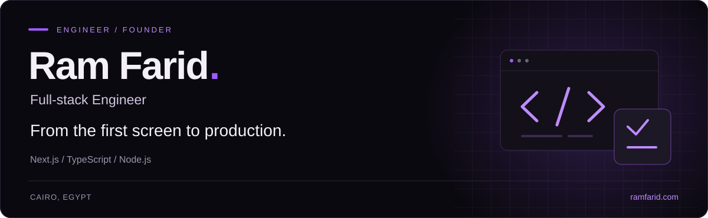
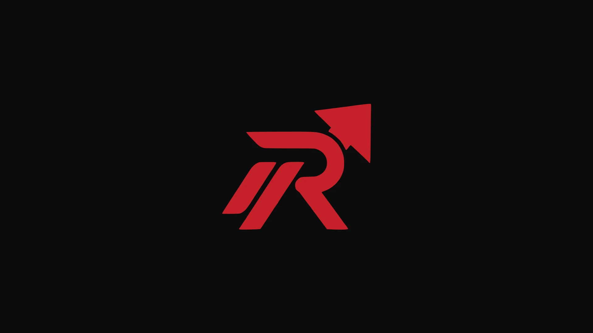
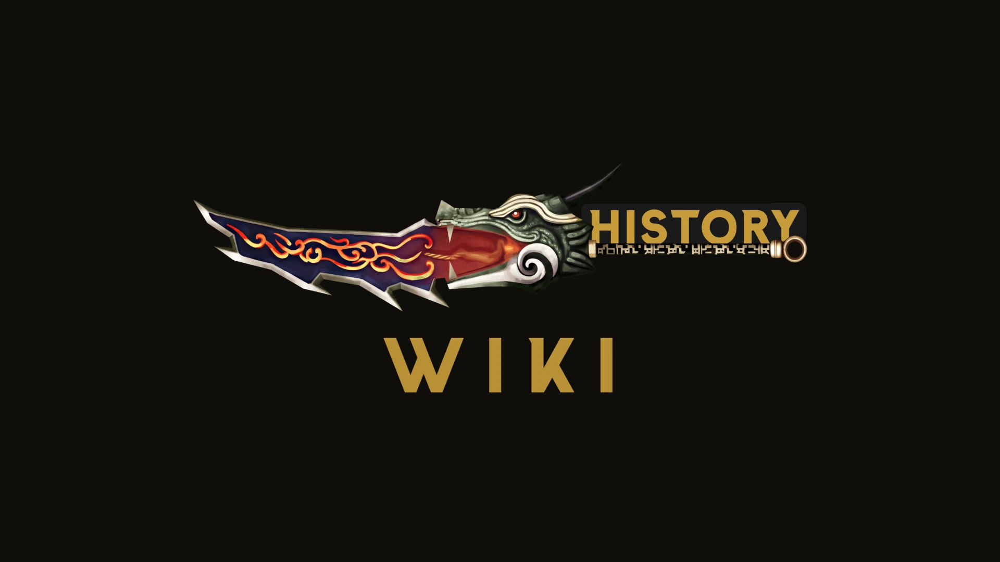

<!-- Content and proficiency levels approved by Ram Farid. Source data: profile.json. -->

# Ram Farid

**Full-stack Engineer · Founder of [Ramlyon](https://ramlyon.com)**

I build web apps end to end: the interface, the API, the database, and the infrastructure that keeps them running. Based in Cairo, working in English and Arabic.

Most of my work is production software for real businesses: ordering and POS platforms, booking systems, commerce, and admin tools. I care about clear interfaces, correct data, and systems that recover when things go wrong.

**Open to full-time, part-time and contract roles.**

[Portfolio](https://ramfarid.com/en/portfolio) · [CV](https://ramfarid.com/api/cv) · [LinkedIn](https://www.linkedin.com/in/ramfarid) · [Email](mailto:ram@ramfarid.com)

## Selected work

The code for client and commercial work is not always public. These case studies show what I built and how it works.

<table>
<tr>
<td width="50%" valign="top">

<h3><a href="https://ramfarid.com/en/portfolio/ramlyon">Ramlyon</a></h3>

Founder · Multi-tenant SaaS

A restaurant operating system: ordering, POS, kitchen display, delivery and staff access. Arabic-first, with real-time updates and offline sync.

<a href="https://ramfarid.com/en/portfolio/ramlyon">Read the case study ↗</a> · <a href="https://ramlyon.com/">Live site ↗</a>

</td>
<td width="50%" valign="top">

<h3><a href="https://ramfarid.com/en/portfolio/history-game">HISTORY website</a></h3>

Game platform · Commerce

A game-connected platform with accounts, rankings, an item shop, referrals and an admin console. Built for a multilingual player community.

<a href="https://ramfarid.com/en/portfolio/history-game">Read the case study ↗</a> · <a href="https://m2history.com/">Live site ↗</a>

</td>
</tr>
<tr>
<td width="50%" valign="top">

<h3><a href="https://ramfarid.com/en/portfolio/history-wiki">HISTORY Wiki</a></h3>

Knowledge platform · CMS

A multilingual game wiki with an in-place CMS, instant search and cached pages. Content tools built around the way its editors actually work.

<a href="https://ramfarid.com/en/portfolio/history-wiki">Read the case study ↗</a>

</td>
<td width="50%" valign="top">

<h3><a href="https://ramfarid.com/en/portfolio/st-mary-maadi">St Mary Maadi</a></h3>

Institutional platform · Reservations

One platform for hotel bookings, Nile trips, tournaments and church events, with capacity management, staff workflows and live updates.

<a href="https://ramfarid.com/en/portfolio/st-mary-maadi">Read the case study ↗</a>

</td>
</tr>
</table>

## Technologies & engineering

My self-assessed levels reflect hands-on experience, not everything I have tried.

### Expert

**Front end** 
`Next.js` · `React` · `TypeScript` · `JavaScript` · `Tailwind CSS` · `MUI` · `MUI X` · `shadcn/ui` · `Sass` · `styled-components` · `Framer Motion`

**State, Data & Validation** 
`Zustand` · `Jotai` · `Zod`

**Back end** 
`Node.js` · `Express.js` · `REST APIs` · `Socket.IO` · `Background jobs` · `Cron jobs` · `Workers`

**Databases** 
`MongoDB` · `Mongoose` · `PostgreSQL` · `MySQL` · `Prisma` · `Redis` · `Firebase` · `Supabase` · `Database design` · `Query optimization` · `Transactions`

**Auth and access control** 
`Auth.js` · `JWT` · `OAuth` · `RBAC` · `Authentication` · `Authorization`

**Architecture** 
`Multi-tenant SaaS` · `ERP` · `SSE` · `WebSockets` · `PWA` · `Offline synchronization` · `Internationalization and RTL` · `Technical SEO`

**Servers and DevOps** 
`Linux` · `Coolify` · `Cloudflare` · `Vercel` · `AWS` · `Hetzner`

**Integrations** 
`Telegram Bot API` · `Nodemailer` · `Bunny.net`

### Proficient

**State, Data & Validation** 
`Redux Toolkit` · `TanStack Query` · `SWR`

**Servers and DevOps** 
`Nginx` · `Docker` · `PM2` · `GitHub Actions`

**Integrations** 
`Stripe`

**Tools** 
`Git` · `GitHub`

### Familiar

**Testing** 
`Jest` · `Vitest` · `React Testing Library` · `Playwright` · `Cypress`

## How I work

- Own the whole path from requirements to deployment, not just the UI.
- Design Arabic and right-to-left experiences from the start.
- Treat tenant isolation, permissions, pricing and data integrity as engineering constraints.
- Keep architecture as simple as the product allows. Add complexity when it earns its place.

## Connect

For roles, product work, or a technical conversation:

[Website](https://ramfarid.com) · [Email](mailto:ram@ramfarid.com) · [LinkedIn](https://www.linkedin.com/in/ramfarid) · [WhatsApp](https://wa.me/201553706448)

[GitHub](https://github.com/RamFarid) · [Facebook](https://www.facebook.com/ramfarid22) · [Instagram](https://www.instagram.com/ramfarid22)

---

Building Ramlyon. Interested in contributing to open source as well.
